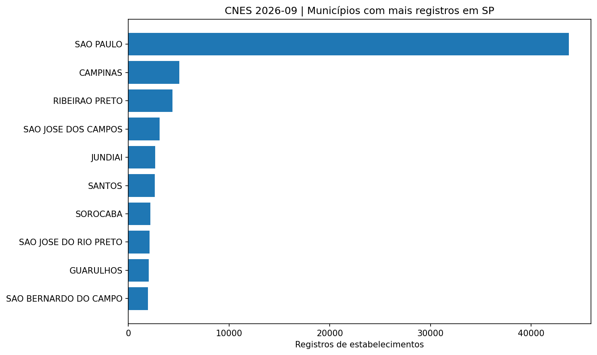
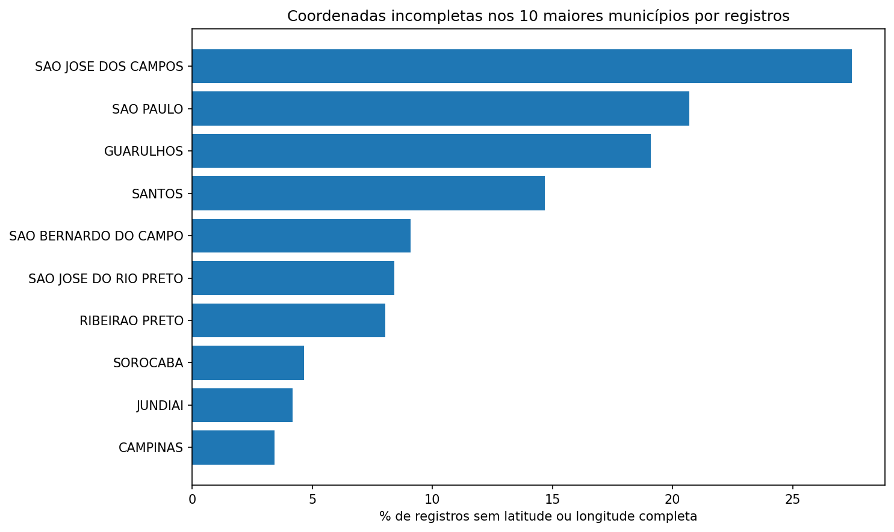
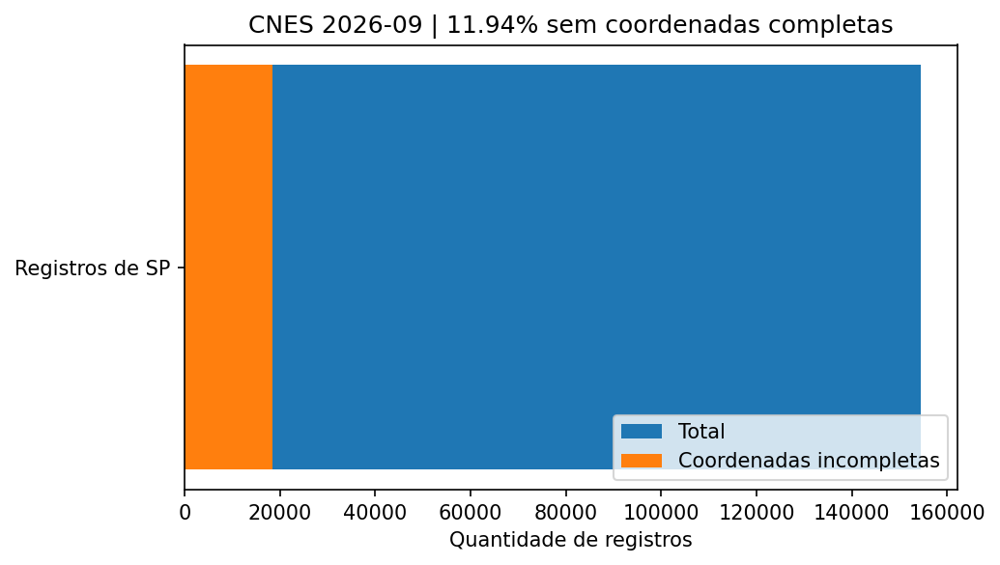

# SUS Data Quality Observatory — São Paulo, Brazil

### Data Quality Engineering | Python | Statistical Analysis | Healthcare Data Analytics

An end-to-end exploratory data quality assessment of healthcare facility registry data from the **Brazilian National Registry of Healthcare Facilities (CNES)**, maintained by the Brazilian Ministry of Health through DATASUS.

This project evaluates the completeness, uniqueness, validity, and consistency of healthcare facility records across **645 municipalities in São Paulo, Brazil**, using the September 2026 CNES dataset.

The objective is to demonstrate practical skills in **Data Quality Engineering, Data Profiling, Data Validation, Exploratory Data Analysis (EDA), and Statistical Reporting**, using large-scale public administrative data.

## Project Overview

Reliable data is essential for analytics, machine learning, operational reporting, and evidence-based decision-making.

Healthcare administrative datasets may contain missing geographic information, inconsistent identifiers, incomplete attributes, and other issues that can affect downstream analysis.

This project implements a reproducible Python-based workflow to identify and quantify selected data quality issues in the CNES registry.

### Key Objectives

- Assess completeness across selected healthcare facility attributes.
- Identify potentially duplicated facility identifiers.
- Validate municipal identifiers against official reference data.
- Quantify missing or incomplete geographic coordinates.
- Compare data quality indicators across municipalities.
- Produce structured reports and visualizations to support further investigation.

## Dataset

| Attribute | Description |
|---|---|
| Data source | Brazilian Ministry of Health — DATASUS / CNES |
| Reference period | September 2026 |
| Geographic scope | São Paulo State, Brazil |
| National records processed | 640,122 |
| São Paulo records analyzed | 154,516 |
| Municipalities represented | 645 |
| Data format | CSV |

São Paulo records were identified using the six-digit municipal prefix of `CO_UNIDADE`, validated against the official `tbMunicipio` reference table.

The municipality responsible for facility management (`CO_MUNICIPIO_GESTOR`) is treated separately from the facility's registered municipality.

The original source files are not included in this repository because of their size.

## Key Findings

| Data Quality Metric | Result |
|---|---:|
| Healthcare facility records — São Paulo | 154,516 |
| Municipalities represented | 645 |
| Records with missing or incomplete coordinates | 18,444 |
| Geographic coordinate incompleteness rate | 11.94% |
| Records with missing facility trade names | 2 |
| Duplicate CNES identifiers | 0 |
| Duplicate facility unit identifiers | 0 |

**Key insight:** Approximately **1 in 8 facility records** in the São Paulo dataset has missing or incomplete geographic coordinates.

These findings describe administrative data completeness and should not be interpreted as measures of healthcare service quality.

## Exploratory Data Analysis

### 1. Healthcare Facility Distribution

São Paulo city accounts for the largest number of registered facilities in the dataset, followed by Campinas and Ribeirão Preto.

This distribution provides context for interpreting absolute counts of data quality issues.

### 2. Geographic Data Completeness by Municipality

Among the ten municipalities with the largest number of facility records, the proportion of missing or incomplete geographic coordinates varies considerably.

| Municipality | Coordinate Incompleteness |
|---|---:|
| São José dos Campos | 27.5% |
| São Paulo | 20.7% |
| Santos | 14.7% |
| Ribeirão Preto | 8.0% |
| Campinas | 3.4% |

**Analytical observation:** São José dos Campos has a substantially higher geographic coordinate incompleteness rate than Campinas.

This difference suggests opportunities for targeted data quality investigation. However, municipal comparisons are descriptive and have not been adjusted for differences in facility composition.

### 3. Statewide Geographic Data Quality

Across São Paulo State, **18,444 out of 154,516 records (11.94%)** have missing or incomplete latitude or longitude information.

This indicator highlights the importance of geographic attribute validation when administrative healthcare data is used in mapping, spatial analysis, or location-based applications.

## Data Quality Framework

The assessment focuses on the following dimensions:

| Dimension | Assessment |
|---|---|
| Completeness | Missing or incomplete facility attributes |
| Uniqueness | Duplicate CNES and facility unit identifiers |
| Validity | Selected identifier and attribute format checks |
| Consistency | Municipal code validation against reference data |
| Data Profiling | Descriptive indicators and municipal comparisons |

The framework is designed to support transparent and reproducible data quality monitoring.

## Technical Stack

| Technology | Purpose |
|---|---|
| Python | Data ingestion, transformation, and validation |
| CSV | Public administrative data processing |
| Matplotlib | Statistical and exploratory visualizations |
| JSON | Structured quality metrics |
| Git & GitHub | Version control and technical documentation |
| Automated Tests | Validation of selected processing rules |

### Core Skills Demonstrated

**Data Quality Engineering · Data Profiling · Data Validation · Data Integrity · Exploratory Data Analysis · Statistical Analysis · Data Visualization · Python · Public Data Analytics**

## Methodology

The analytical workflow consists of six stages:

1. **Data ingestion:** Read official CNES establishment and municipality reference files.
2. **Geographic filtering:** Identify São Paulo facilities through validated municipal codes.
3. **Data profiling:** Examine record counts, missing attributes, and identifier distributions.
4. **Quality assessment:** Apply selected completeness, uniqueness, and validity checks.
5. **Aggregation:** Calculate statewide and municipality-level quality indicators.
6. **Reporting:** Export structured results and generate exploratory visualizations.

## Reports and Outputs

The repository contains the following analytical outputs:

- `RELATORIO_PRELIMINAR.md` — Initial data quality assessment.
- `ANALISAR_VISUAL.md` — Visual analysis and interpretation.
- `indicadores_municipios.csv` — Municipality-level indicators.
- `resumo_qualidade.json` — Structured summary metrics.
- `cnes_repetidos.csv` — Duplicate CNES identifier assessment.

## Limitations

This analysis uses a single CNES reference period: September 2026.

Missing geographic coordinates do not necessarily indicate that a facility is incorrectly located, inactive, or delivering inadequate healthcare services.

Likewise, duplicate detection results depend on the identifiers and validation rules applied.

Municipality-level comparisons are descriptive and do not control for differences in facility types, administrative processes, or reporting characteristics.

The results should therefore be interpreted as **administrative data quality indicators rather than healthcare performance indicators**.

## Future Improvements

- Automated data quality reporting.
- Additional consistency and validity checks.
- Historical comparisons across CNES reference periods.
- Interactive municipality-level dashboards.
- Expanded automated testing.
- Integration with modern analytics and data engineering workflows.

## Author

**Jean Marcos Dias**

Senior Data Scientist | Machine Learning | Statistical Modeling | Data Quality

[GitHub](https://github.com/jmsdiaas) | [LinkedIn](https://www.linkedin.com/in/jean-marcos-dias)

---

*Independent portfolio project based on publicly available data from the Brazilian Ministry of Health / DATASUS. This project is not affiliated with or endorsed by the Brazilian Ministry of Health.*
